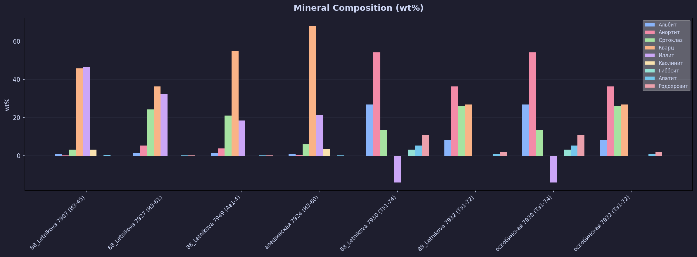
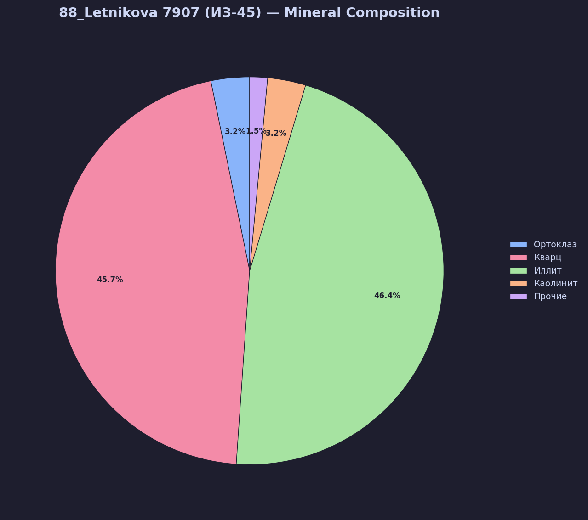
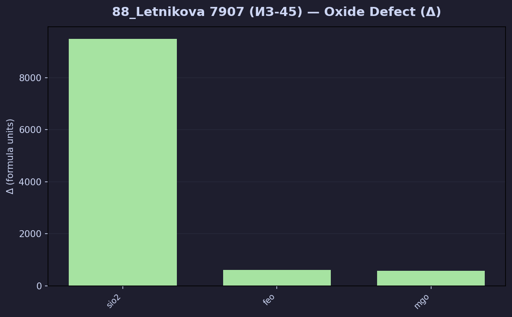
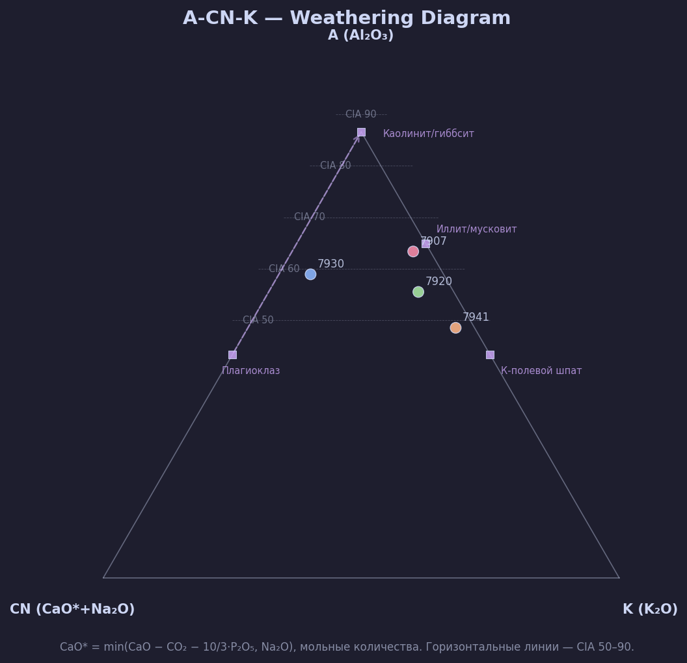
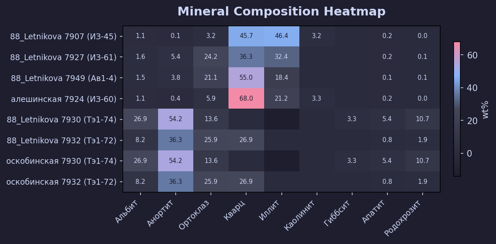
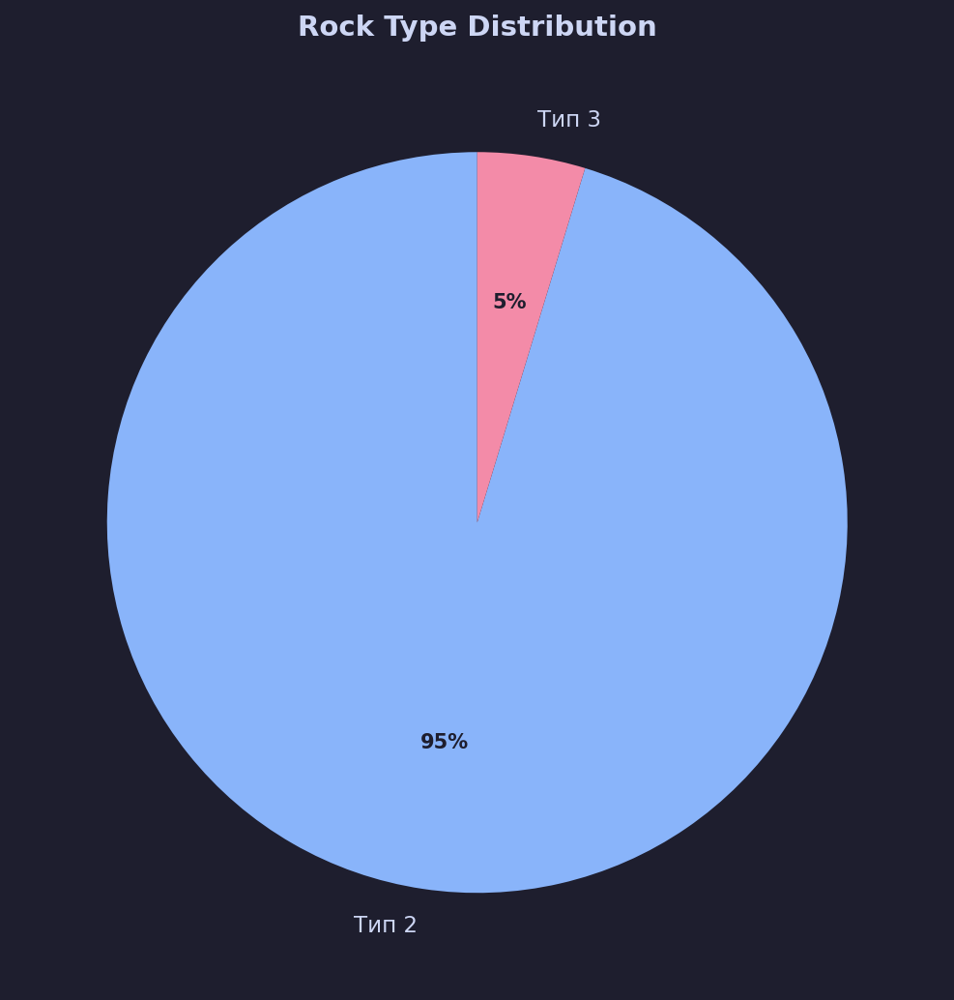
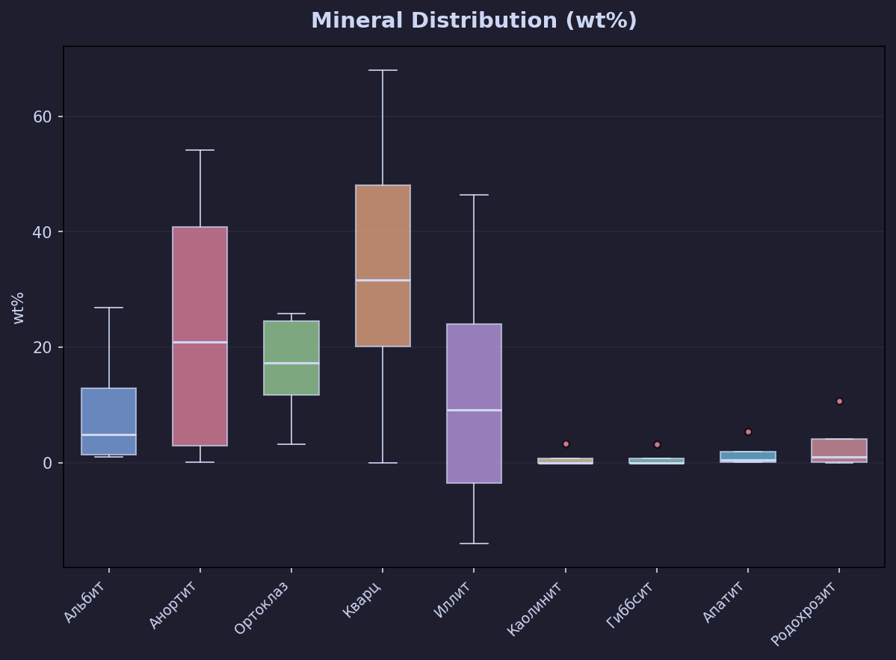
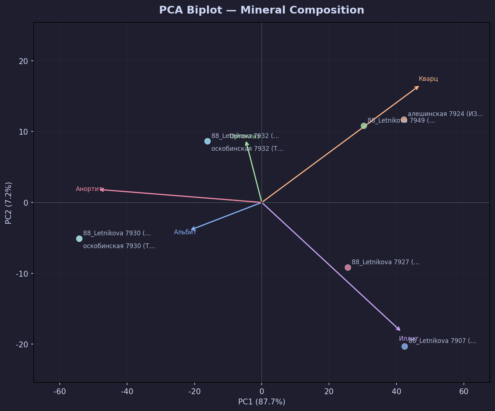

# Актуальный набор диаграмм MINLITH Modern

**Версия:** 0.7.0  
**Состав:** 8 статических диаграмм (matplotlib) + 6 интерактивных (Plotly) = 14.  
**Скриншоты:** `docs/reference/charts_active/` (PNG, 150 dpi, реальные образцы
из `input_85_samples.xlsx`).  
**Печатная шпаргалка:** `CHARTS_ACTIVE_cheatsheet.pdf` (2 страницы A4, текстовая версия без изображений).

Оставлены только диаграммы, которые нужны в повседневной работе с осадочными
породами: состав, контроль невязки, выветривание, распределение типов,
разброс и группировка выборки. Диагностические и дублирующие виды убраны.

## Сводная таблица

| № | Диаграмма | Тип | Что показывает | Зачем нужна |
|---|-----------|-----|----------------|-------------|
| 1 | Mineral Bar Chart | статическая | минеральный состав по образцам | сравнить пробы |
| 2 | Mineral Pie Chart | статическая | доли минералов образца | быстрый обзор |
| 3 | Defect Chart | статическая | остатки оксидов | контроль невязки |
| 4 | A-CN-K | статическая | выветривание и глины | генезис состава |
| 5 | Mineral Heatmap | статическая | образцы × минералы | структура выборки |
| 6 | Rock Type Distribution | статическая | типы 1–5 | представительность |
| 7 | Mineral Box Plot | статическая | разброс минералов | устойчивость, выбросы |
| 8 | PCA Biplot | статическая | главные компоненты | группы и тренды |
| 9 | bar | интерактивная | минеральный состав | то же, с наведением |
| 10 | pie | интерактивная | доли минералов | то же |
| 11 | acnk | интерактивная | A-CN-K | то же, с зумом |
| 12 | heatmap | интерактивная | образцы × минералы | то же |
| 13 | boxplot | интерактивная | распределения | то же |
| 14 | rock_type | интерактивная | доли типов | то же |

---

## Статические диаграммы

### 1. Mineral Bar Chart — минеральный состав по образцам

- **Что показывает:** сгруппированные столбцы; по X — образцы, по Y — мас. %
  минералов, цвет — минерал.
- **Зачем нужна:** основной способ сравнить пробы и увидеть главные фазы:
  кварц, иллит, хлорит, полевые шпаты, карбонаты.
- **Данные:** массы минералов по каждому образцу.
- **Ограничения:** при большом числе проб подписи сжимаются; для десятков и
  сотен проб удобнее heatmap.

### 2. Mineral Pie Chart — состав одного образца

- **Что показывает:** доли минералов для выбранной пробы.
- **Зачем нужна:** быстрый наглядный обзор одного образца для отчёта или
  доклада.
- **Данные:** массы минералов одного образца.
- **Ограничения:** при обилии фаз мелкими секторами (< 1 %) картина плохо
  читается; для сравнения проб не предназначена.

### 3. Defect Chart — невязка по оксидам

- **Что показывает:** остатки (defect) по оксидам — сколько оксида не удалось
  распределить по минералам.
- **Зачем нужна:** первый контроль качества расчёта. Большая невязка указывает
  на неполный или противоречивый анализ либо на редкую ветку алгоритма.
- **Данные:** входные оксиды и результаты распределения.
- **Ограничения:** часть остатка — нормальное следствие эмпирических правил
  MINLITH, а не ошибка программы.

### 4. A-CN-K — выветривание и глинистые минералы

- **Что показывает:** положение образцов в мольном треугольнике
  `Al₂O₃–(CaO*+Na₂O)–K₂O` с линиями выветривания и полями глинистых
  минералов; горизонтали соответствуют CIA 50–90.
- **Зачем нужна:** оценить степень химического выветривания источника сноса и
  направление изменения глинистого материала (полевые шпаты → иллит →
  каолинит/гиббсит).
- **Данные:** мольные Al₂O₃, Na₂O, K₂O и силикатный CaO* (CaO за вычетом
  апатита и карбонатов), с ограничением `CaO* ≤ Na₂O`.
- **Ограничения:** диаграмма рассчитана на терригенные и глинистые породы; для
  карбонатных и хемогенных образований интерпретация ограничена. Поля
  упрощены и не являются точной оцифровкой границ.

### 5. Mineral Heatmap — образцы × минералы

- **Что показывает:** матрицу, где строки — образцы, столбцы — минералы, цвет —
  мас. %.
- **Зачем нужна:** увидеть структуру выборки: группы похожих проб, «пустые»
  минералы, образцы-выбросы.
- **Данные:** массы минералов по всем образцам.
- **Ограничения:** без упорядочивания строк и столбцов картина может быть
  шумной; полезна при десятках и сотнях проб.

### 6. Rock Type Distribution — типы пород 1–5

- **Что показывает:** сколько образцов попало в каждый из пяти типов
  нормативного расчёта MINLITH.
- **Зачем нужна:** быстрый контроль представительности выборки и понимание,
  какие ветки алгоритма задействованы.
- **Данные:** тип породы по каждому образцу.
- **Ограничения:** тип определяется эмпирическими порогами; при малом числе
  проб доли нестабильны. Это внутренняя классификация MINLITH, а не
  петрографическая номенклатура.

### 7. Mineral Box Plot — распределение минералов

- **Что показывает:** ящики с квартилями, медианой и выбросами по каждому
  минералу на всей выборке.
- **Зачем нужна:** сравнить разброс фаз, найти аномальные пробы и устойчивые
  компоненты.
- **Данные:** массы минералов по выборке.
- **Ограничения:** при малом n квартили малоинформативны; нулевые и мелкие
  фазы визуально сливаются.

### 8. PCA Biplot — главные компоненты минерального состава

- **Что показывает:** образцы в плоскости первых двух главных компонент и
  векторы минералов, задающие эти компоненты.
- **Зачем нужна:** найти группы похожих проб и главные направления
  изменчивости (например, «кварц ↔ глины», «карбонаты ↔ силикаты»).
- **Данные:** массы минералов по выборке.
- **Ограничения:** компоненты — линейные комбинации; геологический смысл нужно
  интерпретировать вручную, при малом n результат неустойчив.

---

## Интерактивные диаграммы (Plotly)

Экспортируются в standalone HTML; для просмотра нужен браузер, Plotly JS
подключается через CDN. Интерактивность (зум, наведение) полезна для доклада
и разбора выборки; в PDF/Word/HTML-отчёт попадает статичный снимок.

| Ключ | Что показывает | Зачем нужна | Ограничения |
|------|----------------|-------------|-------------|
| `bar` | минеральный состав по образцам | наведение даёт точные значения | при большом числе проб подписи перекрываются |
| `pie` | доли минералов по образцам | быстрый обзор в презентации | плохо читается при обилии мелких фаз |
| `acnk` | треугольник A-CN-K | зум и подсказки у границ полей | поля упрощены; карбонаты ограничены |
| `heatmap` | образцы × минералы | поиск групп и выбросов | нужна сортировка строк/столбцов |
| `boxplot` | распределения минералов | сравнение разброса фаз | при малом n квартили малоинформативны |
| `rock_type` | доли типов 1–5 | представительность выборки | тип — результат эмпирических порогов |

Все интерактивные виды повторяют статические диаграммы 1–8 и не добавляют
новых типов анализа; отдельные скриншоты для них не дублируются.
